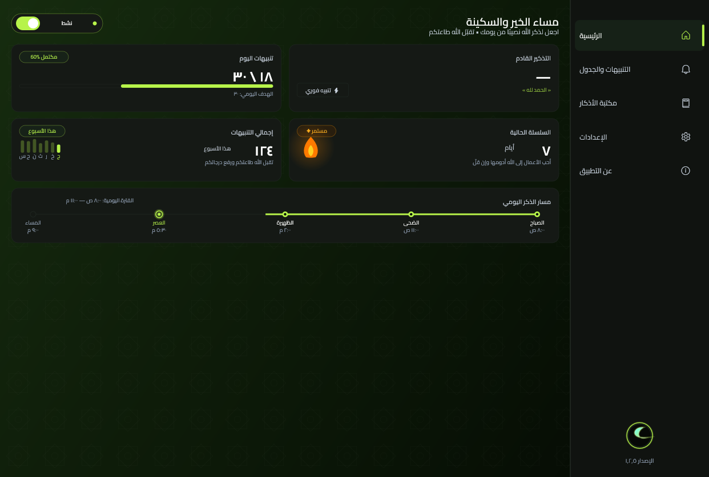
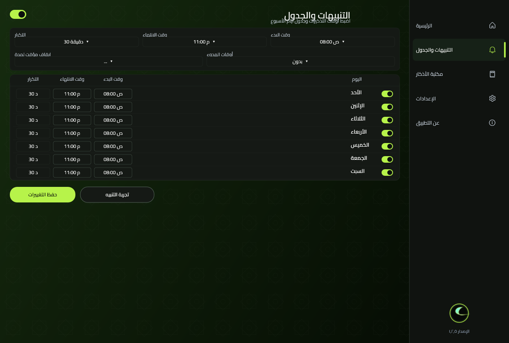
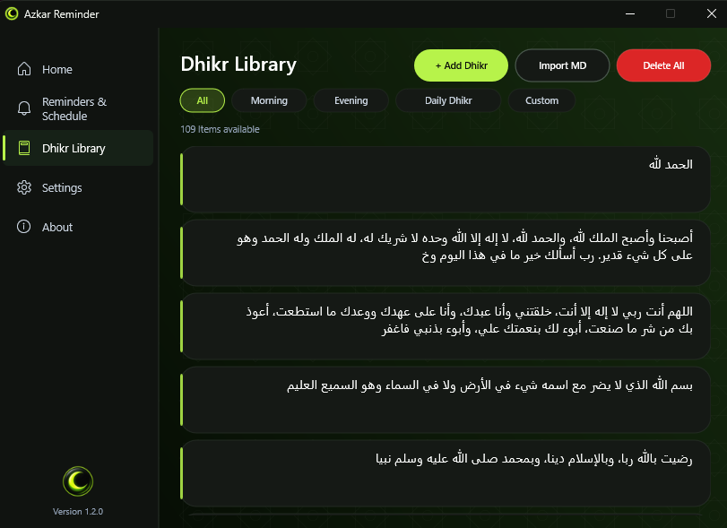
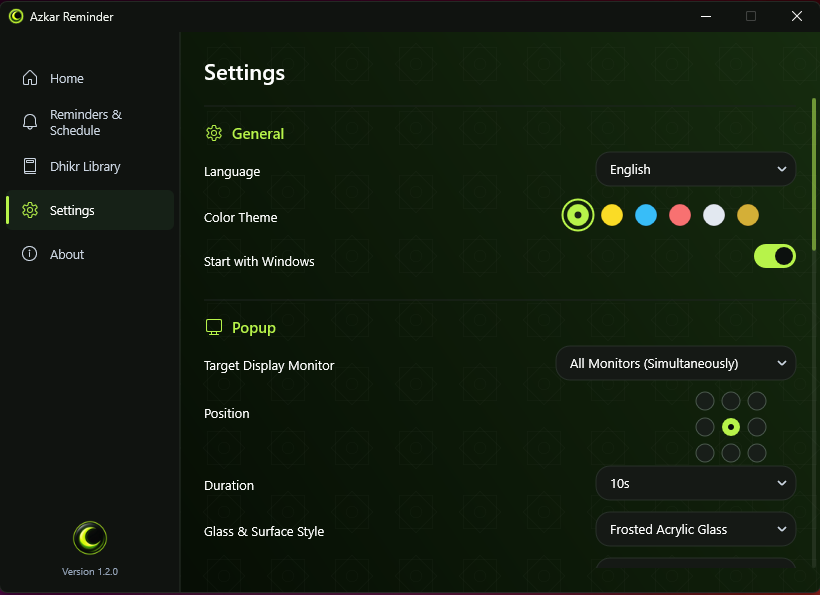

<div align="center">


# Azkar Reminder

**Quiet, native desktop dhikr reminders for Windows, macOS, and Linux.**

[](https://github.com/ahmedkamel6/Azkar-Reminder/releases/latest)
[](https://github.com/ahmedkamel6/Azkar-Reminder/actions)
[](#download)
[](LICENSE)

</div>

---

Azkar Reminder runs quietly in the system tray and displays non-intrusive popup reminders throughout the day. Built in C++20 with native **Win32 + Direct2D** on Windows and **Qt 6** on macOS/Linux — no Electron, no telemetry, 100% offline.

## Screenshots

<div align="center">
  
</div>

| Dashboard | Schedule |
| :---: | :---: |
|  |  |

| Dhikr Library | Settings |
| :---: | :---: |
|  |  |

---

## Download

Grab the latest binaries from **[GitHub Releases](https://github.com/ahmedkamel6/Azkar-Reminder/releases/latest)**:

| Platform | Package | Notes |
| :--- | :--- | :--- |
| **Windows (x64)** | `AzkarReminder-Windows-Setup.exe` / `.msix` | Windows 10 (1809+) or Windows 11, PerMonitorV2 HiDPI |
| **macOS (Universal)** | `AzkarReminder-macOS.dmg` | Drag to Applications; run `xattr -cr "/Applications/Azkar Reminder.app"` if Gatekeeper prompts |
| **Linux (x86_64)** | `AzkarReminder-x86_64.AppImage` | `chmod +x AzkarReminder-x86_64.AppImage && ./AzkarReminder-x86_64.AppImage` |

---

## Key Capabilities

- **Focus-safe popups:** Topmost layered notifications (`WS_EX_NOACTIVATE`) with hover-to-pause, copy, quick-snooze, and interactive tasbih counter.
- **Flexible scheduling:** Per-weekday windows, configurable intervals, quiet hours, and automatic suppression when fullscreen apps or games are active.
- **Custom & built-in library:** Ships with authentic Adhkar in Arabic & English, supports adding custom entries, enabling/disabling items, and safe merge-import (with `.bak` backup).
- **Local-only storage:** History, streaks, and settings stay in `%LOCALAPPDATA%\Azkar Reminder` (Windows) or standard XDG/Application Support directories.
- **Native audio:** Low-latency XAudio2 playback on Windows with automatic device-loss recovery; miniaudio on macOS/Linux.

---

## Building from Source

### Windows (MSVC + Direct2D)

```powershell
cmake -S . -B build -DCMAKE_BUILD_TYPE=Release
cmake --build build --config Release
ctest --test-dir build -C Release --output-on-failure
```

### Linux / macOS (Qt 6)

```bash
cmake -S . -B build -DCMAKE_BUILD_TYPE=Release -DBUILD_QT_APP=ON
cmake --build build --config Release
ctest --test-dir build --output-on-failure
```

See [docs/BUILD.md](docs/BUILD.md) for installer packaging instructions (Inno Setup & MSIX).

---

## Privacy & License

- **Privacy:** 100% offline. No analytics, tracking, or network sync. See [docs/PRIVACY_POLICY.md](docs/PRIVACY_POLICY.md).
- **License:** [MIT License](LICENSE) — third-party attributions in [THIRD_PARTY_NOTICES.md](THIRD_PARTY_NOTICES.md).
